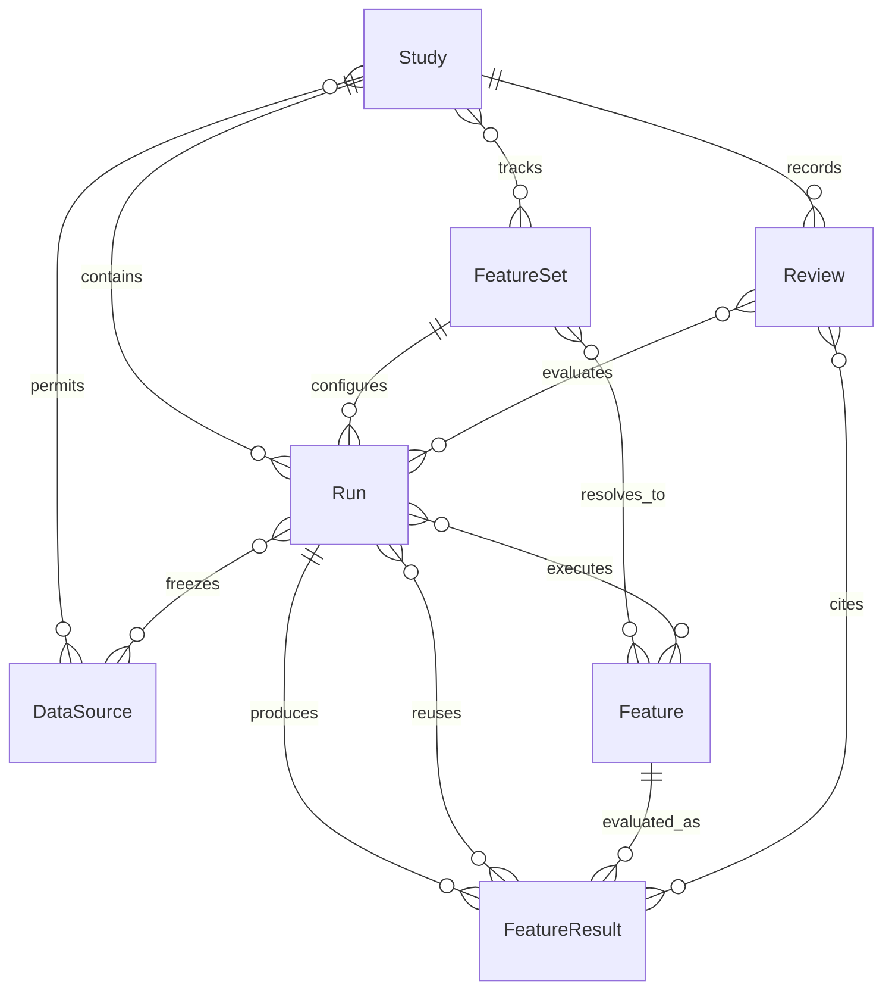

# QuantSage 简化领域模型

实现方案见 [IMPLEMENTATION_DESIGN.md](IMPLEMENTATION_DESIGN.md)：统一 DuckDB 元数据/运行/结果索引，Parquet 存数值。


当前目标：为人工评估与 RSI autoresearch 提供可管理的 **Study / Feature / FeatureSet / Run** 工具。先把 Step 03–05 的配置、渐进探索、执行状态和数据结果管理好，为 events / regimes / phenomena 提供输入。本文件是目标设计，未实现部分见第 8 节。七个模型的必填/可选字段、类型和嵌套结构见 [关键字段字典](domain.detail.md)。

## 1. 四个核心对象，三个辅助记录

| 对象 | 管什么 | 最小内容 |
|---|---|---|
| **Study** | 为什么研究，接下来探索哪些内容 | id、目标、数据源 refs、允许范围/预算、候选 feature refs、默认配置、状态、变更记录 |
| **Feature** | 一个具体指标如何计算 | id/version、step、公式/算法、参数、依赖 refs、采样/时间/有效性规则、单位、定义状态 |
| **FeatureSet** | 要跑哪些显式组合 | id/version、items、参数/窗口/metrics、解析后的 feature refs、冻结状态/hash |
| **Run** | 本次选什么数据、算什么、执行如何 | id、study_id、parent_run_id（可选）、冻结配置/解析计划、代码版本、发起者、开始/结束、逐项执行记录 |
| DataSource | 可追溯的数据版本 | id/version、manifest/artifact refs、内容身份、schema、合约/时间覆盖、日历与可用性规则 |
| FeatureResult | 某 feature 在某范围的结果索引 | id、feature_ref、source refs、实际 scope、input/fit refs、producer_run_id、artifact refs/hash、质量与覆盖 |
| Review | 人或 agent 如何评价并决定下一步 | id、study/run refs、作者/时间、result refs、观察、判断、下一步建议、被后续 run 采用的引用 |

前四个是主要管理入口。数据源复用已有 snapshot/artifact 登记；结果是可查询的索引；评估是追加记录。无需七套独立服务，也不必为每种科学概念建表。



Study 维护显式候选清单，Feature 可跨 Study 复用。Feature 的依赖形成无环图。Run 可以只跑一步或少量组合，不需要经过整个工作流。父 run 仅说明探索来源，不限制复用其他匹配 run 的结果。

行情 metadata（含按合约/交易日生效的 tick_size）由用户补充并版本化，DataSource 和 Run 固定实际引用；补充不重做接入或改写冻结行情。成交量未验证及累计量/增量对账不一致仅警告。深档异常按具体指标依赖生成掩码，不一并禁用有效 L1 指标。

领域计算按真实合约/交易日分区，session 仍是窗口边界。预算不足提交前拒绝；F09/F11/F12 的历史端点统一取同 session 内 `<= t-L` 的最近有效观察并检查冻结的最大 age。默认 trailing 窗口含缺口/NA/stale 时输出 NA，子段画像必须显式启用并另行标识。缺少行情的推荐机制见实施设计 §6.4；统计库固定精确版本，F07/F08 的窗口聚合仍待明确。

## 2. Study：目标与探索清单

Study 保存一句清楚的目标，例如“观察不同流动性条件下 OBI 序列的统计结构”。数据源绑定可以更新，但历史 run 固定其实际使用版本；目标、候选清单和默认配置的修改保留 revision/history，run 记录所依据 revision。

候选清单中每项记录 feature_set_ref + item_id、优先级、加入理由与 active/parked/retired。组合冻结后能解析为具体 feature refs。它定义当前想探索的有限范围，**不会枚举所有合法组合**。新增指标时追加清单；尚未解析成合法定义的想法放在 notes 中，不冒充可执行 Feature。

Study 的默认 scope/配置方便下一次运行；每个 Run 都保存完整解析后的副本。以后改默认值不能改变历史 run。目标已完成可以关闭 Study，状态为 active/paused/closed；关闭不删除结果和失败记录。

## 3. Feature：统一表达 Step 03、04、05

| step / kind | 必需配置 | 依赖 |
|---|---|---|
| 03 / primitive | 源字段、公式、合法空间/size 参数、单位与有效性 | 数据源或其他明确基础依赖 |
| 04 / business | family、space、size、业务 lookback L、聚合/端点/组合公式 | 指定 primitives |
| 05 / statistical | input feature、metric/后端版本、统计窗口 W、采样轴/步长、缺失策略、min_samples、trailing/summary | 指定业务 feature 或 primitive |

每个 Feature 是一个确定组合；family 模板与命名 metric set 是配置便利工具，计划时展开成具体定义并冻结版本。一次选择多项只展开这些项及其依赖，不生成全维度笛卡尔积。catch22 与 tsfeatures 指标同样各有定义身份。

公式、参数、采样或依赖改变创建新版本；display alias 改变不重算。定义状态为 ready/pending_semantics/retired；未明确的 F07/F08 聚合规则不能执行。私有计算中间变量不必登记成 Feature。原始 [L2 公式文档](references/gov_bond_l2_feature_spec.md)不修改。

### FeatureSet：可复用的组合配置

FeatureSet 独立承载 feature、space/size、业务 lookback L、统计窗口 W 和指定 metrics 的显式组合。每项可引用现有具体 Feature，或用精确版本的公式模板与参数生成具体 Feature；两种形式互斥。冻结时展开命名 metric set、解析并保存具体 feature refs，去重但保留条目映射。不包含数据日期或执行状态。

Run 引用一个 frozen FeatureSet 版本，可通过 selected_item_ids 选择其中一部分。显式空列表表示无工作，缺省表示全选；展开仅针对选中条目及其依赖。修改组合发布新 FeatureSet 版本；扩大时间复用原版本。FeatureSet 可跨 Study/Run 复用，Study backlog 引用它的具体条目，不枚举全组合空间。

## 4. Run：冻结配置，按需执行，逐渐扩展

Run 内保存三类信息，不再单独管理 ResearchBatch、ComputationRequest 或 WorkPlan 领域实体：

- **配置**：Study revision、数据源版本、真实合约/半开输出区间、FeatureSet ref/hash 与选中 item_ids、允许 steps、缺依赖策略、资源预算和质量检查。
- **解析计划**：requested/dependency_only 项、完整依赖、所需历史、分区、可复用结果和缺失/阻断原因；执行前冻结。
- **执行记录**：每个 feature × 数据分区的状态、attempts、错误、产生或复用的 result refs；重试保留旧 attempt。

改数据范围、feature 或算法配置建立新 Run，可指向 parent_run_id；失败后同配置 resume 保留 Run。显式重跑也可新建 Run 并复用已有结果。同一提交 request_key 应幂等返回同一 run，agent 重试请求不能重复创建；刻意重复实验使用新 key。Study 的并行修改需要 revision 检查，避免覆盖人工评估。

以下仅为**目标模型的配置示意，不是当前 CLI 可直接执行的 schema**；feature refs 指向已登记的完整定义：

```yaml
study_id: obi_structure
study_revision: 3
parent_run_id: run_a
request_key: obi_structure_expand_dates_01
sources: [l2_snapshot_v1]
scope:
  instruments: [T2406]
  start: '2024-03-04T00:00:00+08:00'
  end: '2024-03-16T00:00:00+08:00'
allowed_steps: [3, 4, 5]
feature_set_ref: obi_profile@1
selected_item_ids: [obi_short, obi_statistics]
missing_dependencies: compute_within_allowed_steps
reuse_verified_results: true
```

只运行 Step 05 时，已有合格 Step 03/04 结果可以引用；缺少依赖且不允许补跑则 BLOCKED。历史读取范围与输出区间分开，不能把窗口不足的输出伪造为完整结果。

A：一周、两个 features → review。B：扩大到一月 → 复用旧分区、补算新日期。C：加入部分 tsfeatures → 复用输入、只算新增定义。分别记录 B/C 相对父 run 的 scope/feature 差异；这些差异是派生视图，不再需要 BatchDelta 实体。

## 5. 哪些没跑、跑了、已有可用结果

不能在 Feature 上放一个全局 `executed=true`。所有查询至少明确 **feature version + 数据源版本 + 合约 + 输出区间 + 相关计算/fit 身份**。

| 维度 | 值 | 含义 |
|---|---|---|
| 本次选择 | requested / dependency_only / not_selected | 是否在当前 Run 的计划内；未选择不代表历史没算过 |
| 执行状态 | PENDING / RUNNING / SUCCEEDED / CACHED / FAILED / BLOCKED / SKIPPED | 存在于 Run 的逐项记录；CACHED 表示本次复用、未重新计算 |
| 处理覆盖 | none / partial / complete | 对查询范围实际处理到哪里，不是有效值比例 |
| 结果可用性 | missing / available / invalid | artifact 是否存在并通过身份、内容、schema 校验 |
| 数值质量 | n_total、n_valid、NA reason counts、quality flags | available 可能全 NA；全 NA 不等于未执行 |
| 评估判断 | unreviewed / keep / investigate / park | Review 意见，不替代执行状态，也不自动代表统计显著 |

**Study coverage** 是跨 runs 的派生查询：以该 Study 当前候选清单和指定 scope 为基础，列出匹配结果、处理/有效覆盖、未处理区间、失败/阻断原因及历史 refs。无匹配执行记录才显示“尚未执行”；历史失败且后来成功应显示当前可用结果，同时保留失败记录。执行过但文件丢失显示“结果不可用”，不能显示“没跑过”。

未登记的无限组合不进入待办总数。展示范围应带 source/feature 版本与过滤条件；“完成率”只针对明确清单和指定 scope。输出可用结果列表与 remaining-work 列表，人工和 agent 都能使用。

FeatureResult 不随使用它的 Run 复制；同一结果可以被多个 Run 引用。只在身份、依赖、内容及覆盖均匹配时复用；分区交集/拼接必须可证明且去重。初版支持精确分区匹配即可，不强求任意时间区间拼接。修改源数据、后端实现或 fit 后重新判断，不直接沿用旧状态。

## 6. 为发现模块准备数据

FeatureResult 索引关联列式 artifact；不把大数组放进 Study/Run。其表或 manifest 至少能解析：

- feature_ref、source refs、instrument、event/observation_time、available_time、session_id，以及值/单位和有效性原因。
- 实际输出/处理/观察覆盖、采样与窗口语义、完整依赖 lineage、代码/算法版本；有学习型 baseline 时附精确 fit artifact、训练范围和截止时间。
- trailing 与 segment_summary 标识；summary 只能在整个区间完成后可知，不能作为区间内的在线特征。

在线输入只用当时可用信息；缺 available_time 证据保留 research_only 或明确延迟假设。L/W 与未来 H 分开；Step 03–05 不以未来响应筛选历史输入。依赖可读取授权的过去历史，并遵守 session、staleness 和 split 约束。

后续 events/regimes/phenomena 使用**明确 result refs + scope + as-of 规则**构造输入，不重新解释 feature 名字。同时保存使用的 result refs，便于追到源数据。异步序列不按行号拼接；按可用时间、合约/会话及失效时间对齐。处理覆盖与有效覆盖都须传递，不能隐式丢掉缺失样本。初期只定义消费契约，不提前实现发现模型。

## 7. 人工与 RSI autoresearch 共用的工具边界

这里把 RSI autoresearch 视为提出下一配置、执行、读取结果并持续调整的调用方，不假定某个具体 agent 框架。人工与 agent 使用同一套工具，不各建一套研究对象。

| 能力（目标接口，非现有命令） | 输入/输出 |
|---|---|
| study.create/get/update | 目标、来源 refs、候选清单、默认 scope/预算；revision 变更历史 |
| feature.register/list/get | 合法定义、依赖、版本与待明确原因 |
| feature_set.create/update/freeze/get | 显式组合、模板/指标集版本、解析 feature refs 与配置 hash |
| run.plan/submit/resume/get | 冻结配置；计划、缓存/缺失清单、预算、逐项状态和错误；提交带 request_key |
| study.coverage | study、source/scope/feature filters；已处理、可用结果、未处理与原因 |
| result.list/get | 精确 refs、质量摘要、artifact/schema、范围与 lineage；读取大表另用限量查询 |
| review.add/list | actor、run/result refs、观察、keep/investigate/park、下一步配置建议 |
| run.compare | 共同/新增范围、feature/配置差异、覆盖与质量差异；不默认给一个优化分数 |

循环：**读取 Study/coverage → 提出少量配置变化 → plan → 执行 → 读取结果 → 追加 Review → 创建下一 Run**。预算、允许数据/steps 从 Study 限制与 Run 请求取交集；agent 不能通过新 Run 自动扩大权限。Review 建议可以自动或人工采用，记录采用依据即可，不要求每次人工批准。

调用方若需要评分，先在 Study 定义评分含义和版本，在 Review 附分数与证据；保留原始质量统计，不能让单一分数隐藏覆盖下降。当前没有自动证明规律或确认收益的承诺。未来真正研究预测效果时再增加专用验证设计；历史观察和访问记录应保留，不把已探索数据叫作独立验证。

## 8. 收敛旧模型与实施顺序

| 原概念 | 当前安排 |
|---|---|
| FeatureSelection | 提升为 FeatureSet 的可版本化组合；Run 引用冻结版本与选中条目 |
| ResearchBatch、DataScope、ComputationRequest、WorkPlan | 合并为 Run 的冻结配置与计划；不要求独立领域仓库 |
| WorkUnit、ExecutionAttempt | 保留引擎内部逐项执行/重试机制 |
| Materialization、OutputBinding、Coverage | 合并为 FeatureResult 的索引/字段及 coverage 查询 |
| DatasetSnapshot、Artifact、SplitManifest | 复用已有基础设施，由 DataSource/Run 引用 |
| BatchDelta、SearchHistory | Run 对比与配置/Review/访问历史；先不建独立科学治理平台 |
| Estimand、EvaluationFold、SearchFamily、EvidenceSynthesis 等 | 后续科学实验阶段再按实际需要引入；不是当前 Step 03–05 工具前置条件 |
| events/regimes/phenomena | 下游消费者，当前只约定输入结果与时间/血缘契约 |

当前 `core.research.WorkDefinition` / `ItemStage` 已有泛型定义与执行适配，`research_batch` 配置/冻结计划已有原型，Registry/artifact store 支持执行历史和精确范围缓存。**保留当前 `research_batch_v1` 配置格式，不在本次文档简化中迁移代码或数据库**；将它作为 Run 配置的现有适配形式。旧文档 batch 一词读作“一次研究配置”，不再意味着独立实体。原型的 parent_batch_ref 仍按现有 run 引用解析。

尚缺：Study 候选清单与 revision 管理、FeatureSet 的编辑/冻结与解析 API、跨 runs 的长期结果/coverage 查询、Review 和统一调用接口、真实 L2/catch22 计算。现有 batch status 只证明单次运行的行为，不等于上述能力已交付。当前证据见 [RESEARCH_BATCH_RESULTS.md](steps/01_workflow_engine/RESEARCH_BATCH_RESULTS.md)。

建议先在 Step 01 完成 Study/Run/结果查询/Review 的最小纵向闭环，继续使用合成 provider 验证；然后分别实现真实 Step 03、04、05。不同时预建后续发现与科学验证模块。

最小验收：登记三个候选只选两个，第三个仍可查询为未跑；扩大日期只补缺失分区；增加统计项复用基础输入；失败可续跑；全 NA 与无结果可区分；源/定义改变不错误复用；文件损坏可检测；人工和 agent 的评估可追踪并产生下一 Run；下游能从结果追溯到输入和可用时间。
