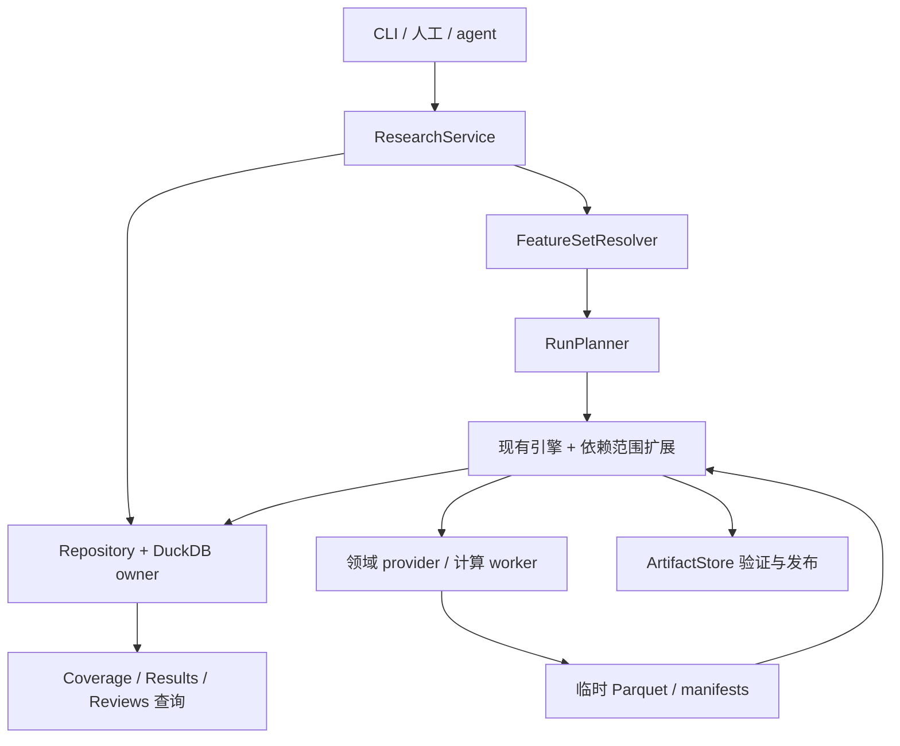

# Study / FeatureSet / Run 实施设计

状态：**待实现设计**。范围为 Step 01 管理/执行扩展与 Step 02–05 数据/特征闭环。数据库统一使用 **DuckDB**。本次设计不改运行代码、数据库或冻结数据。

需求依据：[工作流](WORKFLOW_STAGES.md)、[领域模型](DOMAIN_MODEL.md)、[关键字段](domain.detail.md)。数学定义沿用各 Step SPEC 和只读 [L2 原始公式](references/gov_bond_l2_feature_spec.md)。本文件规定如何实现，不重复维护另一套数学定义。

分步实施入口见 [EXECUTION_SPEC.md](EXECUTION_SPEC.md)：按 14 个增量逐项执行、验收和记录，首先完成 Step 01 管理/执行扩展，再接入真实 Step 02–05 计算；不以本设计文档代替完成证据。

## 1. 交付目标与边界

交付可供人工和 RSI autoresearch 共用的循环：

```text
登记数据源与 Study
 → 编辑/冻结 FeatureSet
 → 指定 scope 和 selected_item_ids，生成 Run 计划
 → 执行/复用 Step 03–05，查询结果与缺失范围
 → 追加 Review
 → 扩大时间或配置，创建下一 Run
```

必须支持少量合法组合、单步骤执行、失败续跑、全 NA、跨 Run 复用及未执行清单。Step 02 的既有 onboarding.json 是来源入口，选新 features 不重新接入。完整 Atlas、条件 baseline、events/regimes/phenomena 和科学实验系统均不在当前实施范围；仅为下游保留时间、质量、血缘契约。

先交付本地单机工具，不部署分布式任务系统。FeatureSet 只管理显式组合，禁止全量计算后过滤。未来 H 不进入 Step 03–05 输入。

## 2. 现有代码与必须补齐的差距

| 已核对的代码 | 复用点 | 必须补齐 |
|---|---|---|
| `core/registry.py: Registry` | runs、stage_runs、状态事件、缓存查询 | 扩展 DuckDB 持久化以支持管理与结果索引；保留公共语义 |
| `core/research.py: BatchEngine/WorkDefinition/ItemStage` | 显式目录解析、依赖去重、授权边界、逐项状态 | 接入冻结 FeatureSet；将管理版本从计算身份中分离；支持具体 Feature 引用及历史范围依赖 |
| `core/workflow.py: WorkflowEngine` | 调度、cache、resume | 现有 `_make_jobs` 的同分区依赖要扩展为显式工作依赖边；提交需支持事务化幂等登记 |
| `core/artifacts.py: ArtifactStore/ArtifactTransaction` | 临时输出、schema/hash 校验、原子目录发布 | 与结果索引/执行成功状态协调提交、崩溃恢复与索引重建 |
| `cli.py` | argparse、JSON、既有命令 | 新增管理命令和统一服务接口；不破坏旧参数与合成示例 |
| Step 02 交付 | 标准化行情、日历/session、质量与来源 | DataSource 注册适配；不改旧产物 schema |

目前 `BatchEngine` 对所有非空请求附加 validation 工作，使用 UTC 日切片并把 `statistical.feature_set_version` 传入统计定义。新路径必须移除无条件实验验证依赖；质量报告仍必需。配置集版本只记录选择来源，算法/协议版本仍进入语义身份。当前代码并不能通过改 YAML 就具备全部新能力。

## 3. 模块与调用关系



建议按交付切片逐步增加下列模块，不预建空类：

| 路径（拟新增/调整） | 责任 |
|---|---|
| `research/models.py` | 严格 schema、ref/scope/状态/版本校验；不执行 SQL |
| `research/service.py` | Study/FeatureSet/Run/Review 用例、幂等、授权与事务边界 |
| `research/repository.py` | 参数化 SQL、版本记录、结果索引和查询 |
| `research/resolver.py` | recipe/metric set → 具体 Feature、语义 hash、条目映射 |
| `research/planner.py` | selected items → 范围化依赖 DAG、缓存候选、预算 |
| `research/coverage.py` | 跨 runs 处理/有效/可用覆盖与 remaining work |
| `core/registry.py`、`core/migrations/` | DuckDB 持久化与 schema 版本管理；保留引擎 Registry API |
| `primitives/`、`features/`、`statistics/` | 后续分别实施 Step 03、04、05 的真实 provider |

不强制新增 Pydantic：可沿用 dataclass + 严格解析，但未知字段、非法组合、未冻结引用须报错。配置中的公式模板只能引用已注册 provider，不能通过任意表达式/动态代码绕过校验。

## 4. DuckDB 存储与并发

### 4.1 文件布局

```text
<workspace>/
  research.duckdb              # 管理、执行、结果索引的唯一活动数据库
  artifacts/<run>/<work>/...   # 不可变 Parquet / JSON + manifests
  staging/<run>/<attempt>/...  # 待校验与提交的文件
  exports/...                 # 有版本/时间标记的查询导出
```

数据数值保存为 Parquet，DuckDB 存元数据及可检索索引，并对明确 artifact 文件集合进行投影/过滤查询。不要对整个 artifacts 目录 wildcard 扫描，也不把 30GB 数组装入 JSON 列。

运行环境当前 DuckDB 为 1.5.5，pyproject 约束为 `>=1.1,<2`。实现时锁定并测试实际交付版本；本设计只依赖常规事务/JSON/Parquet 和本地进程模型，不依赖 DuckDB 2.0 新特性，也不在本次升级依赖。

### 4.2 一个 owner 进程，多计算 worker

采用单进程持有活动数据库连接，所有写入经 owner 队列串行提交；计算 worker 只读已授权 Parquet、写临时产物，通过消息返回结果，不直接写 catalog。活动期间外部 CLI 查询也由 owner 执行，不能假定另一个进程可同时直接打开读写中的文件。这个约束依据 DuckDB 本地并发模型。[官方并发说明](https://duckdb.org/docs/1.4/connect/concurrency)

首个管理切片可用嵌入式 owner：进程持有 workspace 独占锁，其他命令返回 `WORKSPACE_BUSY`。随后增加本地 Unix socket owner 以支持运行中人工/agent 查询；其 RPC 直接调用同一 ResearchService，按请求提供 JSON，不提供远程任意 SQL。socket 位于用户私有目录，只接受本地用户连接；外网服务不在范围内。

metadata 查询优先短事务；大表查询使用同一进程内独立查询连接或 worker 内存 DuckDB 查询不可变 Parquet，不占用元数据写队列。限制查询行数、超时、内存与线程数。先按任务/分区批量写状态，不对每行行情写一次事务。

Study 更新、冻结集合、Run 幂等登记、结果发布各使用显式 `BEGIN/COMMIT/ROLLBACK`。[官方事务说明](https://duckdb.org/docs/1.4/sql/statements/transactions)

### 4.3 表与字段映射

领域只有七个模型；下表是为索引/版本/关联所需的物理存储，不新增领域概念。所有对象 JSON 均有 schema_version；查询字段用 VARCHAR/BIGINT/BOOLEAN/TIMESTAMPTZ 等独立列，复杂配置存 JSON。主键/唯一约束用于保护身份；跨表引用由服务事务显式验证，不依赖级联删除。

| 表 | 主键/唯一约束 | 独立列及 JSON 内容 |
|---|---|---|
| `schema_migrations` | version | checksum、applied_at、DuckDB version |
| `studies` | study_id | current_revision、status、updated_at |
| `study_revisions` | (study_id, revision) | objective、document_json（sources/backlog/limits/defaults）、actor、reason |
| `data_sources` | (source_id, version) | content_hash、manifest_ref、document_json；只读冻结来源 |
| `features` | (feature_id, version) | definition_hash、kind、step、status、document_json；别名可映射到同一语义，不强制 hash 全局唯一 |
| `feature_sets` | (set_id, version) | state、draft_revision、config_hash、document_json；frozen 后不可原地编辑 |
| `feature_set_outputs` | (set_id, version, item_id, output_id) | feature_id/version、definition_hash；冻结时生成，支持一个 metric recipe 多输出 |
| `runs` | run_id | 保留既有执行记录列，加入 study/revision、set/version、request_key/hash；UNIQUE(study_id, request_key)，旧记录无 study 时允许 null |
| `stage_runs` | stage_run_id | 保留旧字段，新增 work_key、record_order；计划范围/角色/具体定义可存 JSON |
| `stage_state_events` | event_id | work/attempt/state/fields/time；顺序显式记录 |
| `feature_results` | result_id | definition_hash、source_binding_hash、computation_fingerprint、instrument_id、start/end、producer_run/work、n_total/n_valid、document_json |
| `run_result_links` | (run_id, work_key, result_id) | produced/reused、scope_json；一个 result 可复用到多个 runs |
| `result_health` | check_id | result_id、checked_at、available/missing/invalid、reason；健康是检查时的状态 |
| `reviews` | review_id | study_id、decision、actor、created_at、document_json；只追加 |

初版 backlog、review refs、细粒度 coverage 放 JSON/manifest；不要为了每个列表再建表。结果按 (definition_hash, source_binding_hash, instrument_id, start, end) 查询；cache 另按 computation_fingerprint 查找。先测典型查询，再决定额外索引。health/event 序号可由 DuckDB sequence 生成，允许不连续。[sequence 文档](https://duckdb.org/docs/1.4/sql/statements/create_sequence)

`runs` 内计划包含工作与依赖边，`stage_runs` 是执行事实，`feature_results` 是结果事实，coverage 为派生视图；不得各存一个互相覆盖的“已完成”标志。实际 schema migration 首次提交必须包含完整 DDL 与升级/回滚测试，本表不是声称已有建表脚本。

## 5. FeatureSet 冻结与计算身份

1. 草稿更新带 expected_draft_revision；冻结时校验模板版本、kind/step、参数单位、metrics 与 metric_set_ref 互斥。
2. 按 item/input refs 建 DAG，拒绝环和歧义。多 metric 输出使用稳定 output_id，下游必须明确引用其中一项。
3. 解析合法组合，继承默认值后显式化；对每个数学定义生成规范化 JSON 与 definition_hash。时区统一 UTC、时长统一内部单位；size 比例保留精确数值语义，不以字符串格式差异区分同值。
4. 冻结 concrete Feature refs、resolved_items、模板/库版本及 config_hash；同时写 Feature 定义、集合及输出映射，全部成功后 state=frozen。
5. pending_semantics 可保留为不可执行定义；冻结集合不代表每项可运行。未知模板/非法参数则拒绝冻结。选中 pending 项时生成 BLOCKED，不影响无依赖的 ready 项。

身份分成三层：

- `FeatureSet.config_hash`：完整选择来源，进入 Run 审计，不单独决定数值复用。
- `Feature.definition_hash`：公式、参数、metric、依赖定义、L/W/采样/有效性语义；不含显示 alias、Study 或集合版本。
- `computation_fingerprint`：定义 hash + 精确输入/源内容 + 输出与历史 scope + split/availability + 实现/环境指纹 + seed/fit（适用时）。当前实现可保守使用整体代码版本，多重算优于错复用；后续缩小到算子实现指纹需新增等价性验证。

`result_id` 还区分实际生产 attempt/artifact；同计算指纹可有多个历史产物，不强制覆盖。再次生产得到不同内容要记录差异，不能悄悄将旧记录改名。

## 6. Run 规划：选择与历史支持范围

### 6.1 规划流程

读取 Study revision 与 frozen FeatureSet → 校验数据源/split/权限 → 解析 selected_item_ids（省略为全部，空为 NO_WORK）→ 展开具体 Feature 和依赖 → 计算每个节点输出/读取范围 → 查询结果及缓存 → 校验任务预算与 allowed_steps → 输出不可变计划。

只做输入元数据校验的 plan 不产生数值。预算无法容纳全部已选目标时拒绝提交并提供缩小建议；首版不静默执行任意子集。未选候选不进计划计数。计划包含每个 work_key、definition_ref、scope、required_history、dependency_work_keys、input_result_refs、role、cache_candidate 和 blocked_reason。

### 6.2 分区与 lookback

领域路径统一使用 `trade_date_v1`：按 `(exchange, instrument_id, trade_date)` 分区，与 Step 02 行情及 Step 03–05 结果一致；时间列仍存 UTC，不能用 UTC 日期替代交易日。一个交易日可含多个连续 session，窗口仍在 session 内计算。现有引擎的 `utc_day_v1` 只保留旧接口兼容，不能直接复用为新分区结果。新日期可复用完全一致的旧切片；首版不保证任意半天边界拼接复用，也不跨源新版本推断内容等价。

历史支持必须由算子依赖传播。例如统计输出 `[a,b)` 的 W 历史，需要业务输入覆盖其评估网格之前 W；业务 L 与过去端点 age 再向源扩展。不能简单只读 `[a,b)`，也不能一律将读取范围扩大为整个源。

规划器递归分配上游输出范围，按稳定分区切分、合并重复工作并生成**显式跨分区依赖边**。缓存缺失的历史输入也是 dependency_only 工作，计入预算/权限；已有结果直接绑定。Step 05 不能绕过 Step 04 结果契约私自用 raw 重造业务特征。

现有 `_make_jobs` 不足以表示这些边，需要新增接受冻结 job graph 的入口，复用原有调度/提交机制；旧 stage×partition 路径保持兼容。worker 读取授权历史、在 session 内计算，最终只发布自己的输出范围。不能跨 session 补足窗口；不足则 NA+reason；元数据/依赖缺失则 BLOCKED。数据无观测与缺少结果文件不同。

验收示例：两个分区之间不切断合法同 session 的 lookback；若真有会话间隔则不连接。追加未来数据不能改变已完成窗口。相同时间点在不同 Run scope 中若完整历史及规则一致，值与 mask 必须一致。

### 6.3 已确认的接入与执行决策

- 行情 metadata 由用户补充，使用带版本/hash 的 `market_metadata_ref`，包含按品种/合约和交易日生效的 tick_size、单位、提供者与来源说明。登记时校验正值、适用范围、规则重叠和所需覆盖；Run 冻结实际引用，计算指纹包含该依赖。补充 metadata 发布 DataSource 新版本，继续引用原行情文件，不改写冻结的 onboarding.json，也不重做行情接入。缺少 tick 只阻断依赖它的指标；不要求额外元数据服务。
- `VOLUME_INCREMENT_UNVERIFIED` 和累计量/增量对账不一致仅警告：保留原值、规则与计数，并传递到相关结果，不因此 BLOCKED、隔离或强制 NA。缺字段、负量、真实 reset 或缺口仍按各指标有效性契约处理；TRADEVOLUME 不再次差分。成交量与成交额不一致分开计数，规则命中和不称为去重异常行数。
- 深档无效按具体指标依赖判断：保留上游质量标记，不因一个深档异常就禁用一档指标；目标规模依赖完整五档的结果不能在缺档后重估目标规模。具体掩码见 Step 03；不把隔离行重新当有效行情。
- F09/F11/F12 的历史端点统一为同 session 内满足 `event_time <= t-L` 的最近有效观察，包含等时记录；保存各依赖命中的源 ID/时间。`max_endpoint_age` 指 `(t-L)-matched_time`，由配置显式给定并冻结；未配置则拒绝该定义执行，超限输出 NA。累计量窗口仍检查全部 reset/缺口证据，不因端点匹配成功就跳过检查。
- catch22 固定 `pycatch22==0.4.5`；tsfeatures 在首次实施时选定一个精确 R 包版本及源码 revision、锁定依赖和 golden fixtures，之后固定使用。版本锁是实施交付项，不再作为需求待决项；升级时创建新实现身份并重新验证。

### 6.4 缺少行情的推荐处理机制

以下为推荐默认策略 `gap_policy_v1`，与已确认的 trailing 缺口规则配套；具体 age/间隔阈值必须配置并冻结，不从全量未来数据估计。

1. 区分有证据的源缺失、隔离事件、观察间隔过长、无效指标值与缺少结果文件。无更新不能自动认定丢包，也不能认定零成交；休市不是缺行情。源发布机制未知时保留 unknown。
2. 从已有 onboarding 入口、隔离引用和覆盖报告派生缺口 manifest，记录合约/交易日/session、时间点或区间、原因、受影响字段、源行 refs 与证据确定性。源区间起点未知时显式标记；不能用上一条 accepted quote 冒充上一条源观察。保存可获得的 reset 证据；不能证明隔离期间累计量连续时，相关窗口输出 NA。
3. 原始快照不插值、不补零。book state 可在同 session 内按 backward as-of 取值，但须满足显式 max_quote_age/max_feature_age，且不能越过已知缺口或相关无效记录；成交量/计数不沿用前值。已知缺失期间不制造成交量零值。
4. Step 04 的窗口碰到影响其依赖的已知缺口或超限观察间隔，输出 NA+reason；只有重新积累完整 L 历史后恢复。单纯某个快照指标不可估时，仍遵守原公式的有效快照均值规则，不能把 F06 可完成性不足一律变成行情缺口。
5. Step 05 默认 trailing 保持父窗口及固定评估时刻，窗口内 NA/stale/缺口使该统计结果为 NA，不 dropna 后拼接。子段画像仅显式启用时另发 segment_summary，带独立 segment_id、父窗口覆盖与实际起止时间，不能冒充完整 W 的 trailing 值；恢复须满足完整 W 的有效历史及上游 L。
6. 无结果文件是执行依赖缺失或结果修复问题；有源缺口并完成诊断的全 NA/零行产物可成功发布，coverage 分别记录 processed、observed、valid，不能把处理完成解释为行情完整。

## 7. 提交、执行、发布与恢复

### 7.1 幂等提交

`plan(request)` 返回 request_hash/plan_hash 和摘要，可用于预览。`submit(request, request_key, expected_plan_hash)` 重新校验精确配置与授权；配置/依赖计划改变则返回 PLAN_CHANGED。缓存健康变化可改变执行动作但不得扩大既定依赖范围；原缓存无效且无法在冻结图内恢复时 BLOCKED。

owner 事务检查 `(study_id, request_key)`：同 hash 返回同 run；不同 hash 为 IDEMPOTENCY_CONFLICT。原子插入 Run、冻结计划与初始任务，再开始派发。新接口必须调整现有 `Registry.create_run`/`WorkflowEngine.run` 的重复登记路径，使“已经登记、尚未派发”可恢复；不能在服务层先建 run 后让引擎再次插入。

Study 已暂停/关闭时不接受新执行；resume 保留旧配置但重新检查当前禁止访问边界。编辑 Study 默认值不修改旧 run；并发 revision 冲突不自动覆盖。

### 7.2 发布协议

数据库事务不能把文件 rename 一并原子提交，采用可恢复的两段协议：

1. owner 登记 RUNNING attempt；worker 写独立 staging 并完成数值/质量自检，返回 payload refs。
2. owner 用 ArtifactStore 校验 schema/hash/依赖；写 durable publication receipt（run/work/attempt、计划/计算指纹、输出 manifests、质量）。
3. 将该 work 的 staging 目录原子发布为不可变目录，再校验最终引用。
4. 一个 DuckDB 事务插入 FeatureResult、run_result_links、SUCCEEDED 与事件；receipt 标识必须幂等。
5. CACHED 也先验证引用，再事务写复用链接与状态；不创建虚假生产者。

崩溃在发布前：没有结果可见，保留失败 attempt，允许重试。发布后、数据库提交前：启动时查 receipt，校验身份和产物后补齐索引/状态，不重复计算。提交后文件丢失：追加 health=missing/invalid，不篡改历史成功；后续执行重算并产生新结果。非法/孤立 receipt 隔离供检查，不自动接纳未知文件或删除证据。

StageResult 即使全 NA 也必须有非空 artifact 映射和质量说明。一旦后台执行中断，记录明确 error_code 并保留事件；resume 使用原配置和冻结图，只重新执行未完成或结果失效任务。

### 7.3 状态和查询

逐项状态沿用 PENDING/RUNNING/SUCCEEDED/CACHED/FAILED/BLOCKED/SKIPPED；Run 展示摘要按 [字段契约](domain.detail.md) 派生，旧引擎原始 status 可保留但不能代替 summary。NO_WORK 不触发验证任务；质量汇总是本次已选范围的派生报告，不是强制科学实验 stage。

## 8. Coverage 与结果查询

`coverage(study, revision, source_refs, scope, optional_set/items)`：

1. 从显式 backlog 或给定集合解析目标定义，按语义去重，保留条目映射。
2. 按精确源/定义/时间政策找到结果候选，校验已发布 manifest 与健康。默认 `verify=true` 做内容校验；快速模式只能返回 checked_at 与 `health_unverified_since_check`，不能声称当前可用。
3. 裁剪各结果的 processed 区间到查询范围，按合约/定义求区间并集；重复缓存引用不重复计数。有效数统计用结果内记录/coverage manifest，不按 min/max 假定连续。
4. 从工作历史补充未执行、失败、BLOCKED、已执行但结果缺失；成功结果可覆盖先前失败，但历史仍可查。
5. 返回 requested/processed/available/valid、unprocessed intervals、needs_repair、reason counts、producer/result refs 及 suggested_work。已处理但文件丢失归修复项，不归“从未执行”。

初版调度复用仅精确分区；查询允许裁剪显示，但这不意味着执行器已支持任意区间拼接。全 NA 可以 processed=complete、available=true、n_valid=0，不自动重算。零行且有可靠源缺口证据可完成处理，available 不表示存在有效行情。

结果读取固定接收 result_refs、列名白名单、scope、limit；通过 manifests 的精确 Parquet 列表查询。空值原因、available_time、session 与来源一起返回。后续发现模块必须按可用时间/as-of 对齐，不能按行号拼接或把 session summary 提前广播。

## 9. 对人工和 agent 的接口

统一 Python ResearchService 作为事实接口，CLI 与本地 RPC 只做解析/序列化。以下名称是目标 API，尚未实现：

| 方法 | 请求关键字段 | 返回 |
|---|---|---|
| `sources.register` | onboarding entry、source id/version | 已验证 DataSource ref、coverage、限制 |
| `studies.create/update/get` | objective、source refs、backlog、expected_revision | Study revision |
| `feature_sets.save/freeze/get` | draft、expected_revision 或精确 ref | resolved_items/hash 或结构化错误 |
| `features.get/list` | refs/kind/状态过滤 | 合法定义与原因 |
| `runs.plan/submit/resume/get` | frozen set、scope、selection、预算；幂等 key | plan/run、逐项状态、结果 refs |
| `studies.coverage` | 有限目标、source/scope、verify | 覆盖矩阵、待办/修复清单 |
| `results.list/read` | refs/范围/列/limit | 元信息或有限行、truncated 标记 |
| `reviews.add/list` | actor、run/result refs、判断/建议 | 追加 Review |
| `runs.compare` | 两个 run refs | 共同/新增日期与定义、质量差异 |

目标 CLI 使用 `quantsage research ...` 新命名空间，避免破坏旧 `quantsage run --config ...`。统一 JSON envelope 为 `schema_version, ok, data, error{code,message,details,retryable}`；分页带 next_cursor，所有比较明确 scope。最低错误集包含 INVALID_CONFIG、REVISION_CONFLICT、UNFROZEN_FEATURE_SET、UNKNOWN_REF、PENDING_SEMANTICS、SOURCE_SCOPE_MISSING、DEPENDENCY_MISSING、BUDGET_EXCEEDED、WORKSPACE_BUSY、PLAN_CHANGED、ARTIFACT_INVALID。无结果是合法查询返回，不是程序异常。

Review 只追加并引用可查证据；多个意见并存。下一 Run 记录 adopted_review_refs，不能由 review.keep 自动更新 FeatureSet、提高预算或声称规律成立。

## 10. 现有接口兼容

`research_batch_v1` 保留兼容适配路径与原有演示，不就地重新解释历史定义。新 FeatureSet 路径直接生成规范化计划，能共享引擎但不强行往旧 schema 塞新字段。保留 Registry 接口及既有运行、状态、产物与缓存查询语义。

## 11. 分阶段实施与验收

每次只实现一个所选 stage；管理扩展属于 Step 01，之后依次推进真实 Step 03、04、05，不一起预建空模块。

| 顺序 | 增量 | 退出证据 |
|---|---|---|
| 01-A | DuckDB Registry 扩展、嵌入 owner | 原 Registry/引擎行为回归；冲突/中断事务与回滚 |
| 01-B | Study/Source/FeatureSet 版本和冻结 | 非法组合、环、默认值、版本/alias、空选择、并发 revision 与幂等提交 |
| 01-C | 规范化计划、范围依赖 DAG、结果发布/coverage/Review | 算术 provider 的 A/B/C、历史分区依赖、缓存/失败/全 NA/损坏/发布崩溃恢复 |
| 01-D | 本地 owner RPC 和统一 CLI | 运行中可查状态；多个客户端不直开活动库；幂等重试、分页/限量查询 |
| 02 适配 | 注册既有 onboarding DataSource | 仅引用原 entry/manifests；旧冻结文件 hash 不变；缺覆盖有明确诊断 |
| 03 | 所选 L2 primitives | 手算不规则行情、历史 tick、space/size、逐指标质量、真实 Step 02 消费 |
| 04 | 所选业务公式和 L | 原公式/端点/reset 顺序正确；pending 不伪造；小范围和扩展范围一致 |
| 05 | 所选统计量、W 与采样 | 固定后端 golden fixtures、仅计算所选指标、session/NA/trailing、primitive-only 入口 |

必须的故障/不变量用例：

- 同一 key 并发 submit 只建一个 Run；同 key 不同请求拒绝；Study/草稿并发修改不丢更新。
- 冻结三项只运行两项，coverage 第三项仍未跑；空选择无工作；未选 pending 不阻塞。
- 加日期复用旧完整分区；新集合增加一项复用其余；改 sampling/size/算法不可误命中。
- 同 session 跨分区历史完整，跨午休不拼接；未知 available_time 仍 research_only。
- 在文件发布前、发布后未提交 DB、DB 提交后各注入故障，恢复状态与产物一致。
- 失败后成功保留 attempts；全 NA、零观测、缺文件和未执行四种情况可区分。
- cached 结果保留实际生产者，跨 Run 覆盖不重复加样本数；追加未来不改历史值。
- 预算不足提交前拒绝；用户 metadata 的 tick 生效范围/冲突/hash 可验证，补充不改冻结行情；成交量警告不会单独阻断计算。
- 深档异常保留有效 L1 指标；历史端点包含 `t-L` 等时记录，端点 age 超限为 NA；真实合约/交易日分区与 session 对齐网格在不同 Run scope 下保持一致。
- trailing 窗口内缺 1s 输出 NA，完整历史恢复后重新有效；显式子段摘要不冒充完整 trailing 值。推荐缺口机制验证隔离/reset 证据及区间起点，区分源缺口与文件丢失。

实装时运行现有 pytest/Ruff、各增量测试及真实域步骤的独立 VERIFY。记录实际通过/跳过项与产物，不沿用旧 123 tests 的数字当新后端验收。只有 Step 03–05 真正完成后，才运行真实小范围 A/B/C 交付；本设计不包含任何伪造市场结论。

## 12. 本设计完成条件

本轮交付仅为设计文档与入口同步。实现完成应能从一个已验证源开始，冻结少量组合，在 DuckDB 查询其运行/结果/待办，追加人工或 agent Review 并启动下一 Run；通过全部相应故障与时间契约验收。高级发现/统计验证不作为这个工具闭环的前置。
