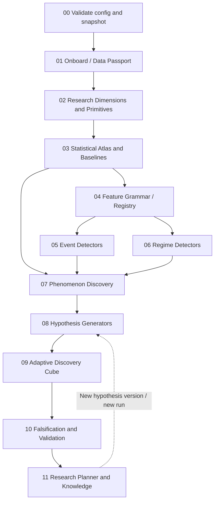

# Step 13 — End-to-End Stage Specification

## 目标

定义**工作流层**的真实依赖、每个 stage 的入参/产物、运行门槛和何时触发下一阶段。与 `steps/01_workflow_engine/SPEC.md` 区分：01 描述执行引擎的通用能力，本文定义研究流程自身。

## 整体 DAG



## Stage-by-stage 执行契约

| ID / stage | 输入 | 核心工作 | 必须持久化输出 | Gate |
|---|---|---|---|---|
| 00 `bootstrap` | config, raw URIs | parse config、snapshot、split | ConfigManifest, SplitManifest | 配置有效、split 冻结 |
| 01 `onboard` | bootstrap, raw data | schema/quality/session 标准化 | Passport, Quality, normalized parquet | 严重时间/schema 错误阻断 |
| 02 `primitives` | normalized, passport | 维度可用性、基础可观测量 | DimensionCatalog, PrimitiveRegistry, primitive parquet | 重要字段语义清晰 |
| 03 `statistical_atlas` | primitives, split | 统计画像、条件 Baseline、依赖图 | Atlas, BaselineManifest, anomaly scores | train-only fit |
| 04 `features` | atlas, primitives | Grammar AST 生成/编译/计算 | FeatureRegistry, feature parquet | type/availability/schema pass |
| 05 `events` | features, baselines | extreme/surprise/divergence/change | EventRegistry, episode parquet | online trigger semantics |
| 06 `regimes` | features, baselines | 状态推断和持续性 | RegimeRegistry, state parquet | no future smoothing |
| 07 `phenomena` | atlas, events, regimes | anomaly/contrast/motif/dependency | PhenomenonRegistry, evidence parquet | evidence+uncertainty 可查 |
| 08 `hypotheses` | phenomena | 六类生成器、竞争解释、反证 | HypothesisRegistry | 可解析 refs、预注册反证 |
| 09 `discovery_cube` | hypotheses, features, regimes | F×C×H 自适应搜索 | CubeRegistry, ExperimentLedger | budget、data fit、split gate |
| 10 `falsification` | cube experiments, controls | 统计/结构/独立测试 | FalsificationReports | holdout 访问控制 |
| 11 `research_planner` | all registry objects | 下一实验选择、知识更新 | ResearchQuestions, summary report | 不删除失败、不重用 holdout |

## 执行模式

- `observatory`: 00–07，**完全不要求未来收益标签**。
- `hypothesis`: 00–09，生成、设计和粗筛实验；保存所有搜索尝试。
- `validation`: 00–11，按冻结定义执行反证与独立测试。
- `report-only`: 不重算统计，只由现存 artifact 生成报告。

## 三层研究产物

1. **Facts**：直接可计算的数据统计事实（例如 ACF、分布、异常分数）。
2. **Phenomena**：需要解释的结构化观察（例如深度下降而 mid 不动）。
3. **Hypotheses**：对未来响应/条件差异/机制的可检验陈述及其反证。

下游不应倒灌结果，把已知的未来收益证据写回前面的“无监督观察”，以免研究叙事产生 hindsight bias。

## 一条具体数据流（示例，非真实回测结论）

```text
L1 snapshot T (irregular updates)
  ↓ schema / session / quote-age validation
mid, spread, bid_depth, OBI, quote_interarrival
  ↓ baseline by session and past volatility
bid_depth_change_30s is in conditional lower 1% tail
  ↓ event detection and episode dedup
BidDepthDepletionEvent at detected_time
  ↓ observed relation with mid
Phenomenon: depth falls sharply while mid remains stable
  ↓ G1/G5/G6 hypothesis generators
H1 continuation vs H2 absorption vs H3 session confound
  ↓ Cube cells
(F=depletion, C=liquidity states, H=1m/5m/30m)
  ↓ matched controls + block bootstrap + untouched holdout
SUPPORTED_IN_SCOPE / INCONCLUSIVE / FALSIFIED ...
  ↓ research planner
What additional condition/test best separates the explanations?
```

## Stage 间复跑规则

`onboard` 输入数据变化 → 全下游失效；baseline 方法/训练期变化 → atlas 和下游失效；features grammar 变化 → features 和下游失效；仅报告模板变化 → 只重绘报告。实验定义和 split 一旦冻结，需通过新版本而非原地更新。

## 产出检查

系统必须能在一次运行后显示：`stage graph`, `started/finished`, `artifact refs`, `data coverage`, `n_candidates_generated/tested/rejected`, `why stage skipped`, `reason a candidate was retained/rejected`。控制台汇总可短，详细证据留在 report/artifact。

**配套文档**：01（调度机制）、14（数据契约）、15（实施和验收）。
