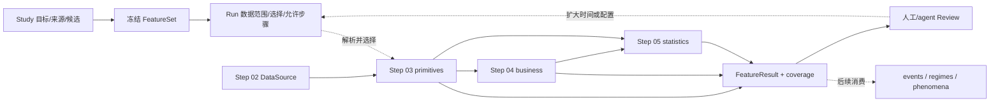
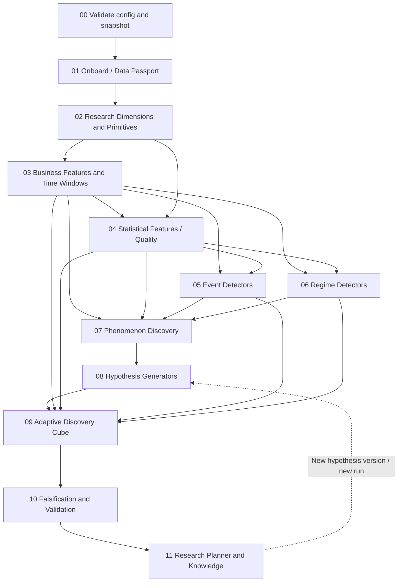

# Workflow — Step 02–05 数据与特征探索

## 当前目标与交付边界

当前建设目标是 **Study → FeatureSet → Run → FeatureResult → Review → 下一 Run**：支持人工和 RSI autoresearch 选择一段数据、计算少量合法组合、检查结果，再扩大日期或 features。领域对象和字段以 `docs/DOMAIN_MODEL.md`、`docs/domain.detail.md` 为准。

Step 01 提供管理/执行基础；Step 02 提供可复用数据源；Step 03–05 交付特征数据。events/regimes/phenomena 是后续消费者，不是本轮 Run 成功的前置。原先完整研究 DAG 保留在本文后半部分作为路线图，不代表每次必须从头到尾执行。

## Step 02–05 当前执行契约

| Step / workflow stage | 解析后输入 | 当前必需工作 | 必需交付 | 不强制执行 |
|---|---|---|---|---|
| 02 / 01 onboard | 原始源选择、mapping、质量/日历/session 规则 | 冻结来源、标准化、质量/覆盖审计 | 既有 onboarding.json、行情/隔离/日历 artifacts；管理层映射为 DataSource | 指标计算；因新 FeatureSet 重做接入 |
| 03 / 02 primitives | DataSource refs、选中 primitive 及依赖、scope/history | 基础量和快照公式、reset/有效性/血缘 | Feature(kind=primitive) + FeatureResult | 全参数空间、自动研究规划、无关跨合约/成交量 bars |
| 04 / 03 features | 所需 primitive results、选定业务组合 | 保留原公式的合法 space/size/lookback L、窗口与端点组合 | Feature(kind=business) + FeatureResult | 全量 432 项数值、自动造公式、任何统计拟合 |
| 05 / 04 statistical_atlas | 所选业务或 primitive results、W/sampling/metrics | 所选基础描述/catch22/tsfeatures 和质量记录 | Feature(kind=statistical) + FeatureResult | 完整 Atlas、条件 baseline、异常/依赖模型及科学检验 |

`statistical_atlas` 暂保留为既有 stage key，当前展示名称是 Statistical Features & Quality；命名兼容不扩大必需输出。

已确认执行规则：用户补充版本化行情 metadata（含历史 tick），不重做行情接入；成交量未验证/对账不一致仅警告；深档无效按指标依赖传播；预算不足提交前拒绝；历史端点取同 session 内 `<= t-L` 最近有效记录并检查最大 age；领域结果按真实合约/交易日分区；统计库固定版本。默认 trailing 遇缺口/NA/stale 输出 NA，子段画像须显式开启。缺少行情推荐机制见 [实施设计 §6.4](IMPLEMENTATION_DESIGN.md#64-缺少行情的推荐处理机制)。



箭头表示数据依赖，不表示所有节点必跑。Step 05 若只选 primitive 可跳过 Step 04；已存在合格依赖时直接复用。FeatureSet 冻结具体定义；Run.plan 只展开 selected_item_ids 及其依赖并检查源覆盖、历史、预算和 allowed_steps。缺少依赖且不允许补算时 BLOCKED，不自动从原始接入开始。

## 运行前后需要记录什么

1. **准备**：引用已验证的 DataSource；冻结 FeatureSet 版本，明确 size 含义/单位、业务 L、统计 W、采样与 metrics。未来 impact H 不进入这些输入。
2. **计划**：Run 绑定 Study revision、FeatureSet ref/hash、source/split refs、输出 scope 和选择。缺省选择全部配置条目；显式空数组是 NO_WORK。显示依赖、预计缓存、缺失和阻断原因。
3. **执行**：按具体 feature × 精确分区记录状态与 attempts；只计算新增/缺失部分。私有中间量可共享，但公共结果必须可追踪。
4. **结果**：产物校验通过才 SUCCEEDED/CACHED；区分处理覆盖、artifact 可用性、n_total/n_valid 和 NA 原因。全 NA 可以是完成的合法结果，无文件不能算完成。
5. **评估**：Review 引用真实 run/result 记录判断和下一配置建议；质量 PASS/keep 不表示规律或预测效果成立。
6. **扩展**：同 FeatureSet 扩日期用新 Run；改组合发布 FeatureSet 新版再运行。源/定义/实现/fit 改变重新判定缓存；配置集换版不强制重算其中未变的定义。共同/新增范围分别展示。

Study.coverage 只针对有限 backlog、指定源版本和范围回答“尚未执行/失败/有结果/部分覆盖”。FeatureSet 不记录全局 executed 标志。Run 配置变化不能原地覆盖历史；resume 只恢复同配置。管理接口与真实计算各自验收，不将算术 provider 演示当成真实 L2 结果。

## 当前验收闭环与状态

最小场景：A 小范围选两个业务组合和少量统计项；B 同配置集扩日期，复用匹配分区；C 同范围加统计项，只补新依赖。检查未选候选、pending_semantics、缺历史、失败重试、全 NA、产物丢失、版本变更和结果血缘。只跑 Step 04/05 的入口也应独立可用。

Step 02 已有实际交付与冻结验收；本轮文档不改写其产物。Step 01 泛型批次扩展为 PARTIAL，完整 Study/FeatureSet/Review/跨 Run coverage 待交付；Step 03–05 仍为 NOT_STARTED。当前 YAML 示例是目标模型，不声称新管理 API 或真实特征 CLI 已可运行。

## 整体 DAG（后续研究路线图）



## 全工作流阶段映射（后续阶段按需实现）

| ID / stage | 输入 | 核心工作 | 必须持久化输出 | Gate |
|---|---|---|---|---|
| 00 `bootstrap` | config, raw URIs | parse config、snapshot、split | ConfigManifest, SplitManifest | 配置有效、split 冻结 |
| 01 `onboard` | bootstrap, raw data | schema/quality/session 标准化 | Passport, Quality, normalized parquet | 严重时间/schema 错误阻断 |
| 02 `primitives` | normalized, passport | 维度可用性、基础可观测量 | DimensionCatalog, PrimitiveRegistry, primitive parquet | 重要字段语义清晰 |
| 03 `features` | primitives, fixed pack config | 业务公式、合法参数域、lookback windows | FeatureRegistry, feature parquet | type/availability/schema pass；无需 Atlas |
| 04 `statistical_atlas` | 所选 features 或 primitives、冻结 FeatureSet、split | 所选统计画像与质量 | statistical Feature/FeatureResult、fingerprint parquet；Atlas/baseline 延期 | trailing/summary、采样和覆盖可验证 |
| 05 `events` | features, statistical features, baselines | extreme/surprise/divergence/change | EventRegistry, episode parquet | online trigger semantics |
| 06 `regimes` | features, statistical features, baselines | 状态推断和持续性 | RegimeRegistry, state parquet | no future smoothing |
| 07 `phenomena` | features, atlas, events, regimes | anomaly/contrast/motif/dependency | PhenomenonRegistry, evidence parquet | evidence+uncertainty 可查 |
| 08 `hypotheses` | phenomena | 六类生成器、竞争解释、反证 | HypothesisRegistry | 可解析 refs、预注册反证 |
| 09 `discovery_cube` | hypotheses, features, statistical features, events, regimes | F×C×H 自适应搜索 | CubeRegistry, ExperimentLedger | budget、data fit、split gate |
| 10 `falsification` | cube experiments, controls | 统计/结构/独立测试 | FalsificationReports | holdout 访问控制 |
| 11 `research_planner` | all registry objects | 下一实验选择、知识更新 | ResearchQuestions, summary report | 不删除失败、不重用 holdout |

## Step 与 workflow Stage 的编号映射

实施 Step 01 是引擎，workflow Stage 00 是 bootstrap，因此后续编号存在偏移：Step 03 → Stage 02 primitives；Step 04 → Stage 03 features；Step 05 → Stage 04 statistical_atlas。旧目录 04_statistical_atlas_and_baselines 与 05_feature_grammar 已迁移为 04_business_features 与 05_statistical_features；步骤名/路径不再代表旧顺序。

## 时间与研究边界

业务 lookback L、统计窗口 W 和未来 impact horizon H 分开记录。Features 与 trailing statistical features 均仅回看；event/regime 依据当时已可用的输入识别。H 只用于后续实验 outcome，不能提前进入状态定义。统计窗口底层依赖包含输入业务 lookback；session/缺口/split/可用时间校验必须覆盖完整依赖。

Events 与 regimes 默认并行；事件历史摘要只有在显式状态模型声明时才作为 regimes 输入，不建立双向环。对未来响应的研究用于检验事件/状态的含义，后续定义更新须创建新版本/新 run。

## 研究批次：小范围验证后逐步扩大

DAG 是依赖图，不是每次必跑的全流程。一次研究批次指定数据区间/合约、少量业务和统计 feature 组合、目标产物与质量检查（科学验证协议仅在后续实验需要时使用）；可停在任意已授权步骤，或以已有 artifact 为边界单独继续后续步骤。

典型循环：A 在小范围计算少量组合并验证；B 扩大数据时间、复用 A 的匹配结果并补算新范围；C 增加 feature 组合、复用已有依赖并执行新增验证。下一次 Run 保留父运行引用、定义/时间/配置变化与评估历史，旧结果不覆盖。

逐批报告已处理/缺失数据范围、选中与新增指标、执行/缓存/失败状态，以及验证结论。数值/覆盖率检查、探索效果检验、冻结候选的独立验证是不同协议；扩大样本后需重新形成相应汇总，不以缓存命中代替新验证。Future impact H 仅在明确的实验协议中读取，不能进入当前信号/状态。允许执行的 stage 范围是硬约束，缺少边界输入时阻断，不自动从头跑。

泛型批次与跨 run 逐项复用已有合成数据实现；真实领域指标和完整研究治理仍未交付。当前能力与边界见 Step 01 的 RESEARCH_BATCH_RESULTS.md；目标领域关系见 DOMAIN_MODEL.md。


## 当前管理模型：Study / Feature / FeatureSet / Run

以 `docs/DOMAIN_MODEL.md` 为准。Study 记录目标、数据源和有限候选清单；Feature 统一表达 Step 03/04/05 的具体版本与依赖；FeatureSet 承载 features/size/L/W/statistics 的显式组合并冻结具体定义引用；Run 引用其版本、选中条目和数据范围，再冻结执行计划。DataSource、FeatureResult 与 Review 是辅助记录；字段见 `docs/domain.detail.md`。研究批次只是 Run 的配置，不再要求独立 Batch 实体；现有 `research_batch_v1` 配置继续兼容。

人工与 RSI autoresearch 共用“查 coverage → 选少量配置 → plan/run → 查结果 → review → 下一 run”循环。哪些未跑以候选清单和明确数据范围为准；选择状态、执行状态、处理覆盖、结果可用性、数值质量和评估意见分开。只运行所选步骤与授权依赖，不要求完整 DAG。

当前重点是特征数据基础，保留源/定义版本、可用时间、会话规则、质量与完整血缘。后续 events/regimes/phenomena 通过明确 result refs 与 as-of 规则消费数据。高级实验/统计检验对象推迟到实际研究响应时引入；当前运行完成或 review.keep 不表示科学规律获得验证。此处是目标设计，已有泛型引擎的交付范围仍以其结果报告为准。

## 全流程扩展模式（非当前必跑范围）

- `observatory`: 00–07，**完全不要求未来收益标签**。
- `hypothesis`: 00–09，生成、设计和粗筛实验；保存所有搜索尝试。
- `validation`: 00–11，按冻结定义执行反证与独立测试。
- `report-only`: 不重算统计，只由现存 artifact 生成报告。

## 三层研究产物

1. **Facts**：直接可计算的数据统计事实（例如 ACF、分布、异常分数）。
2. **Phenomena**：需要解释的结构化观察（例如深度下降而 mid 不动）。
3. **Hypotheses**：对未来响应/条件差异/机制的可检验陈述及其反证。

下游不应倒灌结果，把已知的未来收益证据写回前面的“无监督观察”，以免研究叙事产生 hindsight bias。

## 后续全流程数据流（示例，非当前验收及真实回测结论）

```text
L1 snapshot T (irregular updates)
  ↓ schema / session / quote-age validation
mid, spread, bid_depth, OBI, quote_interarrival
  ↓ business lookback windows
bid_depth_change_30s, activity and price-response features
  ↓ trailing catch22 / tsfeatures + baseline by session and past volatility
bid_depth_change_30s is in conditional lower 1% tail
  ↓ event detection and episode dedup
BidDepthDepletionEvent at detected_time
  ↓ observed relation with mid
Phenomenon: depth falls sharply while mid remains stable
  ↓ G1/G5/G6 hypothesis generators
H1 continuation vs H2 absorption vs H3 session confound
  ↓ Cube cells
(F=depletion, C=liquidity states, H=1m/5m/30m)
  ↓ matched controls + block bootstrap + untouched holdout
SUPPORTED_IN_SCOPE / INCONCLUSIVE / FALSIFIED ...
  ↓ research planner
What additional condition/test best separates the explanations?
```

## Stage 间复跑规则

按具体定义、源/输入引用、scope、实现和 fit 重新判断受影响依赖的复用；不要仅因 stage 名称或 FeatureSet 版本改变就全局清空缓存。业务公式/L/primitive 变化影响引用它的业务/统计结果；metric/W/采样变化只影响相应统计及其下游；新增日期补算缺失分区；仅报告模板变化只重绘报告。实验定义和 split 一旦冻结，需通过新版本而非原地更新。

## 产出检查

系统必须能在一次运行后显示：`stage graph`, `started/finished`, `artifact refs`, `data coverage`, `n_candidates_generated/tested/rejected`, `why stage skipped`, `reason a candidate was retained/rejected`。控制台汇总可短，详细证据留在 report/artifact。

**配套文档**：01（调度机制）、14（数据契约）、15（实施和验收）。
