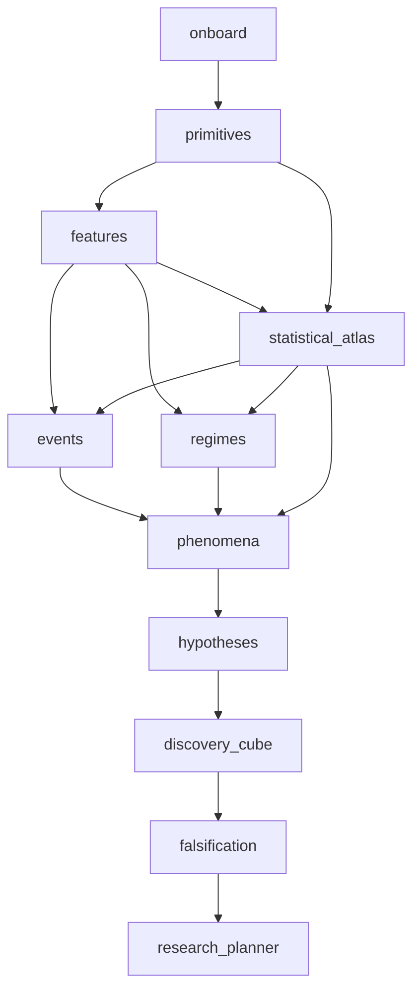

# Step 01 — Workflow Engine

## 目的与边界

构建一个**执行科学发现流程的编排引擎**，而不是一个业务算法。它不理解 OBI 或价格，只负责各 Stage 的类型化输入输出、依赖关系、缓存、重试、血缘、资源预算和状态。

## 当前实施设计

以 [IMPLEMENTATION_DESIGN.md](../../IMPLEMENTATION_DESIGN.md) 为新管理路径的实现依据：DuckDB Registry、单 owner、Study/FeatureSet、幂等 Run、显式范围依赖、结果发布/coverage/Review。现有 SQLite 基础和泛型 batch 原型保留历史事实；新路径按设计逐项迁移验证，不声称已完成。完整 Atlas/条件 baseline 不属于当前 Step 03–05 前置。

## 输入 / 输出

- **输入**：validated YAML config、DAG definition、Stage registry、源数据快照/manifest。
- **输出**：唯一 `run_id`、每个 stage 的 `stage_run_id`、状态与耗时、持久化 ArtifactManifest、调试日志和失败原因。
- **状态**：`PENDING | RUNNING | SUCCEEDED | FAILED | SKIPPED | CACHED | BLOCKED`。

## 设计的基础接口

```python
class Stage(Protocol):
    name: str
    version: str
    dependencies: tuple[str, ...]

    def validate(self, ctx: RunContext, inputs: dict[str, ArtifactRef]) -> None: ...
    def execute(self, ctx: RunContext, inputs: dict[str, ArtifactRef]) -> StageResult: ...

@dataclass(frozen=True)
class StageResult:
    artifacts: dict[str, ArtifactRef]
    metrics: dict[str, float | int | str]
    warnings: list[str]
```

建议 `RunContext` 最少包含 `run_id, config_hash, split_id, data_snapshot_id, as_of_cutoff, artifact_store, rng_seed, logger, resource_budget`。`as_of_cutoff` 是业务信息可用性截止，而不是处理器运行时间。

## 最小 DAG

本图表示允许的数据依赖，不要求每次从起点跑到终点。默认交互模式是研究批次：选择一段数据和少量 feature 组合，计算并验证后，再扩大时间或指标范围。每批冻结目标/验证协议、复用已验证产物、只计算新增依赖；完整批次配置与比较/扩展规则见 [IMPLEMENT.md](IMPLEMENT.md) 的 `Research batches` 部分。这是待实现扩展，不是当前 CLI 已支持的能力。



注意：`events` 和 `regimes` 可以并行；`features` 从 primitives 直接计算业务窗口；后续 statistical_atlas 计算所选统计特征及质量，条件 baseline 延期，events/regimes 联合消费两类产物。把所有上游阶段固化为 artifact，而非隐藏的 Python 内存状态。

## 调度和缓存

### 显式组合与逐特征执行扩展（待实现）

配置、规划接口、缓存粒度和逐项状态的完整实施契约见 [IMPLEMENT.md](IMPLEMENT.md) 的 `Explicit combinations`、`Item-level execution` 和 `Fine-grained cache` 部分，验收见 [VERIFY.md](VERIFY.md)。此扩展尚未由既有 Step 01 结果验证。

- 用显式 items 选择业务 family/space/size/lookback，以及每个输入的统计 metrics/profile window；不隐式展开全维度笛卡尔积，也不全量计算后再过滤。
- 引擎使用插件 catalog 定义的合法组合，解析选中输出的依赖闭包并冻结 WorkPlan；领域公式仍由 Step 03–05 实现。
- 每个定义 × 合约/数据分区 × 请求区间独立记录状态、attempt、输入/产物引用和处理覆盖；定义层汇总必须反映部分完成。
- 区分本次未选择、选中未执行、执行成功、缓存复用、失败/阻断/跳过，以及已正确运行但全部 NA；禁止用一个 `executed=true` 混合这些含义。
- 添加独立请求或新日期范围应尽量复用已有匹配分区结果，旧 run/plan 和失败证据保持不可变。

### Stage 调度基础

1. 拓扑排序；发现环则拒绝运行。
2. 计算 stage cache key：`stage version + normalized config subset + input artifact hashes + split/snapshot ids + code revision`。
3. 如果已有完整可验证 artifact，则命中缓存，否则执行；不可依据目录存在就跳过不完整任务。
4. 每个任务写到临时分区/文件，验证 schema + hash 后**原子发布** manifest；失败不应留下假成功。
5. 允许 `--from`, `--until`, `--only`, `--resume`, `--force-stage`，强制重算后应使相关下游缓存失效。
6. 任务应支持分区范围（合约×交易日）；按 partition id 复跑，跨分区汇总作为独立 stage。
7. 大量结果通过 `ArtifactRef(uri, schema_version, hash, partition_keys, row_count, time_min/max)` 传递，不能把整张 DataFrame 放到调度状态。

## 资源和日志

- v1 `LocalExecutor` 限定最大并发数、DuckDB memory_limit、临时目录、线程数、单阶段最大候选数。
- 日志结构包含 run/stage/partition/candidate id、开始结束时间、耗时、peak memory（可观测时）、输入输出 hash、异常栈。
- 参数校验失败与数据质量阻断不得悄悄继续；可选特征缺失允许带 warning 跳过。
- 重试仅用于幂等、瞬时失败；对 schema 错误、数据泄漏检查失败不自动重试。

## 推荐 CLI

```bash
quantsage validate --config examples/quant_discovery.yaml
quantsage plan --config examples/quant_discovery.yaml
quantsage run --config examples/quant_discovery.yaml --until features
quantsage run --config examples/quant_discovery.yaml --resume <run_id>
quantsage status --run-id <run_id>
quantsage artifacts --run-id <run_id> --stage events
quantsage explain --artifact-id <artifact_id>
```

## 验收

- 单元测试：DAG 依赖/环检测、cache key、输入缺失、失败恢复、重试分类、原子发布。
- 集成测试：用合成数据执行 `onboard→primitives→features→statistical_atlas`，第二次执行应产生 `CACHED`，修改阈值仅使受影响阶段及后继失效。
- 测试中模拟中途断电/异常；`--resume` 不重复写出成功分区，输出内容 hash 不变。
- 每个 Stage 能定位自己的参数版本、原始数据 snapshot 和上游输入。

**依赖**：`../../COMMON_CONTRACTS.md`。**下一步**：`../../steps/02_data_onboarding/SPEC.md`。
